---

title: BumbleBook Book Inventory Application

---

# BumbleBook

Towards the end of our degree, all students at SNHU are required either to complete an internship in a relevant field or a capstone course. I'd always wondered what this sort of course would consist of, that it could be considered the academic equivalent of several weeks at what is essentially a part-time job, but now that is clear to me: both options are aimed at giving students something tangible to show employers that they are capable of the kind of work we'll be applying for. Internships give recommendation letters and completion certificates, but the capstone course has given my the time and space to produce a complete original piece of software to show employers, not just my ability to build a medium-scale functional project, but my coding style, the care I put into my work, and a bit of my non-computational passions when they see that my app is not just a secure and working application, but a potential product that would fill a hole in the current market that I'm a part of. 

Of course, the capstone course wasn't a blanket, do whatever you'd like to prepare a nice artifact. The assignment was to make changes to previously existing projects proving skills in 3 areas: Software Design and Development, Algorithms and Data Structures, and Databases. I chose to make changes to the same application for each category: a mobile application for database display which I created for CS 360: Mobile Application Development. The application, BumbleBook, is specifically for the display of a database of books, including separate entries for multiple printings of the same book over multiple years and publishers. There is a log-in function, and had planned to add ways for the user to add, edit, and delete items in the database. 

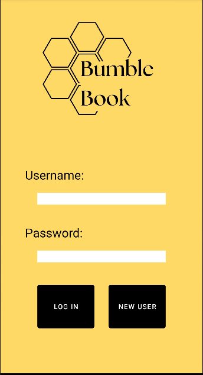
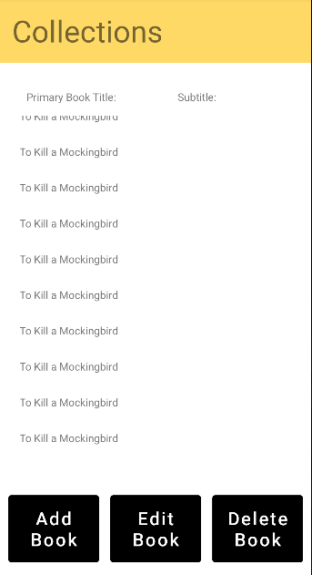

[Pre-Enhancement Program Code](https://github.com/w8itsk8/CS360-Final)

The first step was developing a plan to meet course requirements and complete a code review:

  <iframe
    src="https://www.youtube.com/embed/JsA9_epdNeA"
    title="BumbleBook Code Review Video"
    style="position: absolute; top: 0; left: 0; width: 100%; height: 100%;"
    frameborder="0"
    allow="accelerometer; autoplay; clipboard-write; encrypted-media; gyroscope; picture-in-picture"
    allowfullscreen>
  </iframe>

I elected to fulfill requirements for the Software Design and Development by adding the originally planned functionality for making changes to the database. The version of the app turned in for my CS360 final project had three buttons for altering the database on the app's home screen (the main database display): "Add Book", "Edit Book", and "Delete Book". I started by adding code so that a user can tap a row in the displayed database to "select" that book. Selecting a book adds it to a temporary item and makes the edit and delete buttons functional. Tapping a record again de-selects that book and empties the contents of the temporary item. Next, I created the Add/Edit Book activity, a new screen in the app conjured when a user presses the "Add Book" button, or selects a record and presses the "Edit Book" button. This meant making an XML for the design of this new screen, and a Java file to define have the new activity interacts with the user and the home database. Lastly, I added functionality to the "Delete Book" button and a Toast pop-up for the user to confirm before they permanently delete that record.

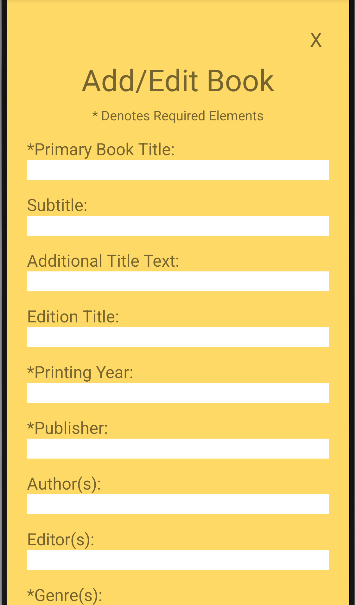
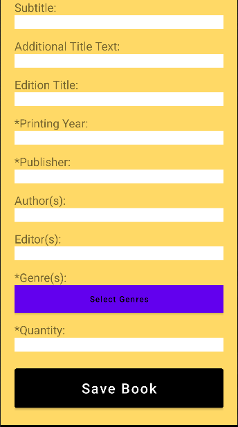

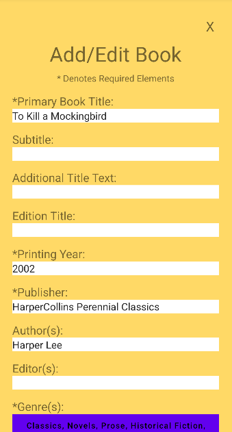
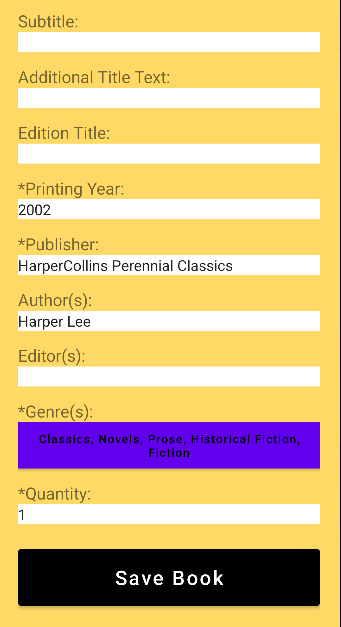

Requirements for the Algorithms and Data Structures portion of the project were fulfilled by fundamental changes to the way in which data was stored using data structures. I started by creating two unique structs: Book and Genre. Genre was the more complex addition, because I wanted there to be a predefined bank of genres for a user to select and a complex, tiered checklist of genres for the user to select on the Add/Edit Book screen, where the check of a specific sub-genre automatically selects all of the broader heading genres leading to it (so checking Sonnet would automatically select Stanza Poetry, Poetry, and Fiction). Separate Java files were created to hold the GenreSelections and GenrePicker. The Book struct holds attributes for each column including the one of type Genre. 

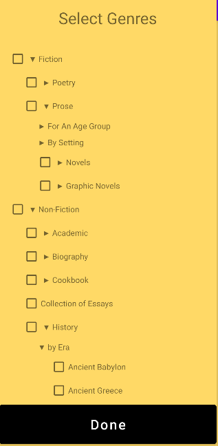
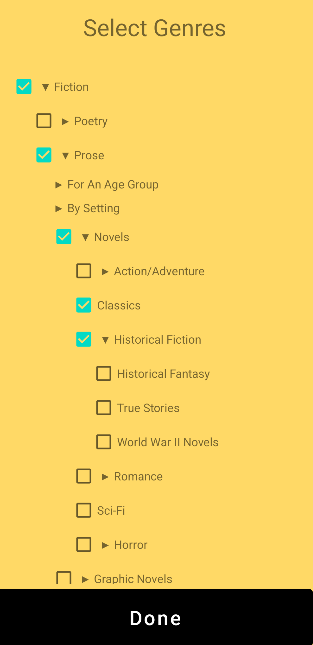

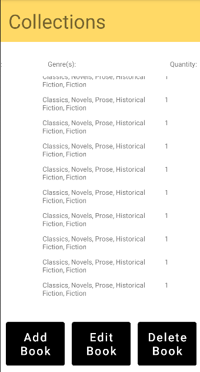

I fulfilled the last set of requirements, showing my skills with utilizing databases, by adding functionality to the log-in screen and database. On initially creating this app, the data table I implemented for log-in information was created in the same way that the one for the book data was, and authentication was simply double checking that the entered username and password matched those on a row in the log in table. For this enhancement, I added the basic functions necessary for encryption using a randomly generated string key, and added a new column to the log-in table for the encryption key of each password. I then added functionality to the "New User" button on the log-in page, starting with defining a new activity for registering a new user. I created a XML design file for the AddUser activity, re-using much of the code from the log-in activity's design, but adding a third text entry field and label for a password confirmation. Lastly, I added the java file to define the functions behind the AddUser activity, making sure the fields have entries, the username is unique, and that the password and password confirmation fields match, and adding the new user to the log-in database. 

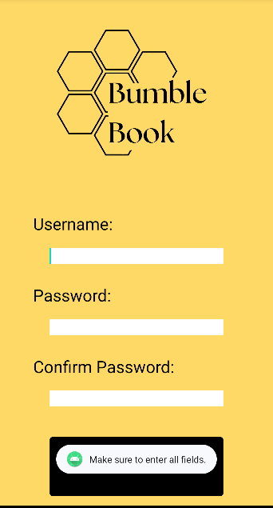
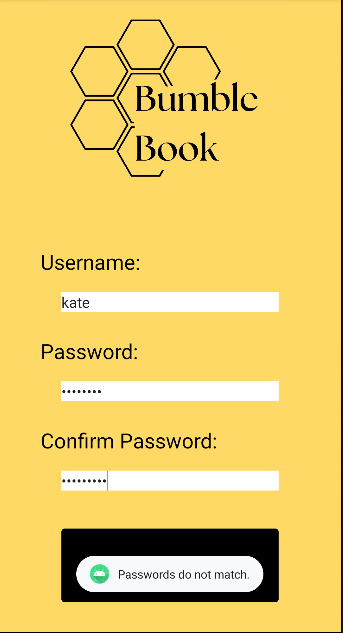

[View the code on GitHub](https://github.com/w8itsk8/BumbleBook)

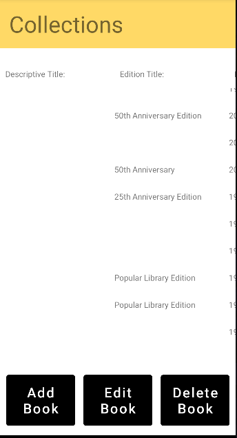
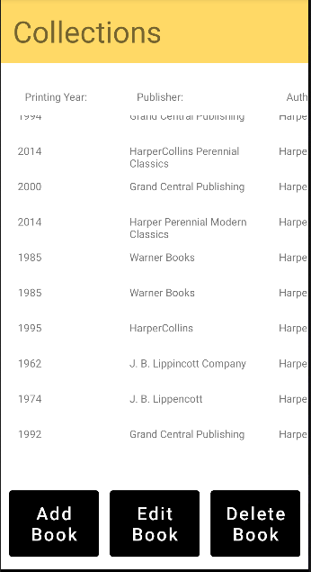
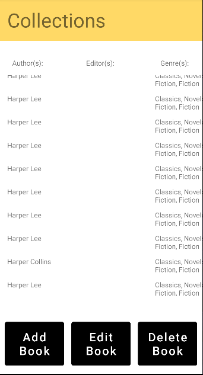

